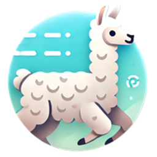
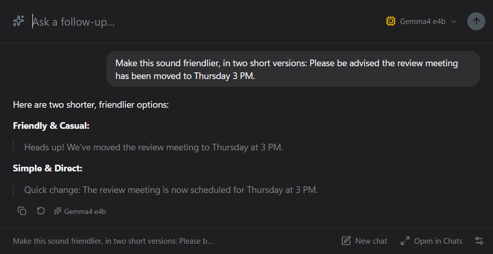
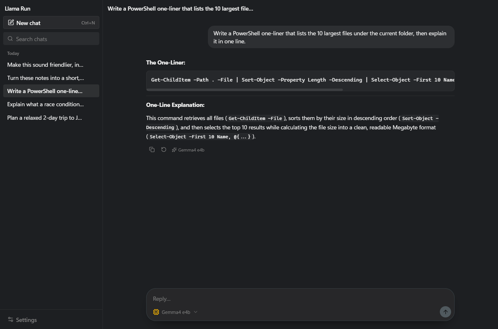
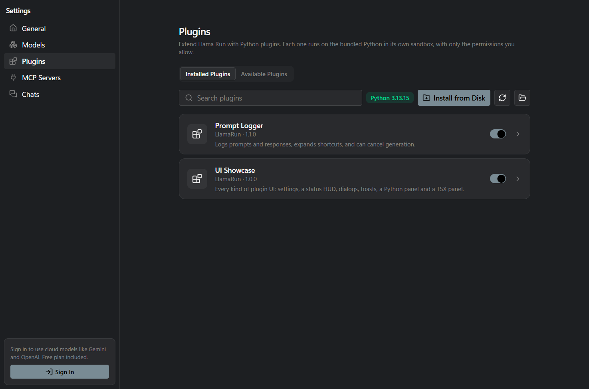
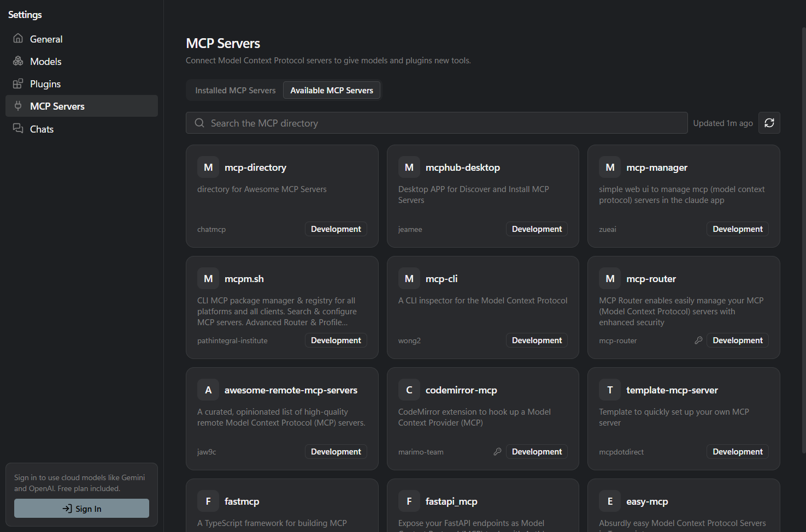

<div align="center">



# LlamaRun

**The extensible AI assistant for Windows.** Press <kbd>Ctrl</kbd> + <kbd>Shift</kbd> + <kbd>A</kbd> in any app and ask. Run free, private models on your own PC with Ollama, or use cloud models, and extend it with MCP servers, Python plugins and skills.

[](https://github.com/KrishBaidya/LlamaRun/releases/latest)
[](https://github.com/KrishBaidya/LlamaRun/actions/workflows/build.yml)
[](LICENSE)
[](https://github.com/KrishBaidya/LlamaRun/releases/latest)
[](https://github.com/KrishBaidya/LlamaRun/stargazers)

[**Download for Windows**](https://github.com/KrishBaidya/LlamaRun/releases/latest) · [Website](https://llamarun.krishbaidya.me) · [Plugin SDK](docs/plugin-sdk.md) · [Report a bug](https://github.com/KrishBaidya/LlamaRun/issues/new)



</div>

## Why LlamaRun

The overlay opens on top of whatever app you are in, so you can ask a question without switching windows or pasting text into a browser tab. Press Esc and it's gone.

Local models through [Ollama](https://ollama.com) run free on your own PC, and your chats are saved as files on your disk. Cloud models (Gemini, OpenAI) sit in the same model picker for when you want them.

You can connect any [MCP](https://modelcontextprotocol.io) server, install `SKILL.md` skills (the same format Claude uses), or write a Python plugin with its own settings, panels and tools. The bundled Plugin Creator plugin lets the AI build new plugins for itself.

LlamaRun 1 launched on the Microsoft Store in 2024 and reached 1,000+ users. This repository is LlamaRun 2, a full rebuild in Electron, React and TypeScript.

## Install

1. Download `LlamaRun-Setup-<version>-x64.exe` from the [latest release](https://github.com/KrishBaidya/LlamaRun/releases/latest) and run it. The installer isn't code-signed yet, so Windows SmartScreen may warn you: choose **More info**, then **Run anyway**.
2. For local models, install [Ollama](https://ollama.com/download) and pull a model, for example `ollama pull gemma3`. For cloud models, sign in with Google from Settings. Pro is free during early access.
3. Press <kbd>Ctrl</kbd> + <kbd>Shift</kbd> + <kbd>A</kbd> anywhere. <kbd>Esc</kbd> hides the overlay.

## Screenshots

| Chat window | Plugins |
|---|---|
|  |  |

<p align="center"></p>

## Features

- Overlay: a frameless, always-on-top window for quick questions. Follow-ups continue the same thread, Ctrl+N starts a new one, and "Open in Chats" moves it to the full window.
- Chat window: saved, searchable history, a model picker per chat, copy and regenerate, and automatic summaries of long chats (or type `/compact`).
- Attachments: paste, drag or attach images, PDFs, Word documents and text files. Images go to vision models.
- Rich answers: streaming Markdown with code highlighting, Mermaid diagrams, SVG, and live HTML previews right in the chat.
- Memory: the AI remembers what you tell it about yourself. You can see, edit or clear it in Settings.
- Skills and `/` commands: add skills from a ZIP, a folder or a GitHub link. Skills live in the shared `~/.agents/skills` folder, and your Claude Code skills appear automatically. Type `/` to run any skill or plugin command.
- MCP: browse a directory of MCP servers and install them in one click. STDIO and Streamable HTTP/SSE servers both work, with local and cloud models.
- Computer use: turn it on in Settings and the AI can open apps, click, type and press keys on your PC through [Cua Driver](https://cua.ai/docs/cua-driver). It works in the background, so your own mouse and keyboard keep working. It asks before it controls each app, and you can stop it any time with <kbd>Ctrl</kbd> + <kbd>Alt</kbd> + <kbd>Esc</kbd>.
- Python plugins: each plugin runs on a bundled Python 3.13 in its own sandboxed process, with only the permissions you approve. Plugins can add tools, `/commands`, settings pages, panels (in Python or TSX), dialogs and notifications. See the [Plugin SDK](docs/plugin-sdk.md) and the [examples](examples/plugins).
- Windows-native feel: Mica and Acrylic backdrops, your accent colour, a tray icon and launch at login.

## Roadmap

- Public launch on the Microsoft Store, Product Hunt and Hacker News.
- A plugin marketplace for sharing AI-built tools.
- macOS and Linux, then teams.

Ideas and bug reports are welcome in [Issues](https://github.com/KrishBaidya/LlamaRun/issues). If LlamaRun is useful to you, a ⭐ helps other people find it.

## Build from source

Requirements: Node 20+ and Git.

```bash
npm install          # also downloads the bundled CPython into resources/python/
```

```bash
npm run dev          # run with hot reload
```

```bash
npm test             # main-process unit tests (vitest)
```

```bash
npm run test:sdk     # Python SDK tests, run with the bundled interpreter
```

```bash
npm run build:win    # NSIS installer in dist/
```

Useful environment variables:

| Variable | Purpose |
|---|---|
| `LLAMARUN_USER_DATA` | Use a separate profile directory, e.g. `./.devdata` |
| `LLAMARUN_SERVER_URL` | LlamaRun backend. Default: `https://llamarun.krishbaidya.me` |
| `LLAMARUN_MCP_DIRECTORY_URL` | MCP directory. Default: `https://mcp.krishbaidya.me` |
| `OLLAMA_HOST` | Ollama endpoint |
| `LLAMARUN_PYTHON` | Use another interpreter if the bundled one is missing |
| `LLAMARUN_SKIP_PYTHON=1` | Skip the Python download during `npm install` |

## Project layout

```
src/main/        Electron main process: windows, tray, hotkey, settings, auth
  llm/           Ollama + cloud proxy (headless generate())
  mcp/           mcp.json, client manager, directory API
  plugins/       per-plugin Python processes, permissions, broker, installer
    ui/          plugin UI: HUD, dialogs, sandboxed panels, TSX compiler
src/preload/     typed contextBridge API (window.llamarun)
src/shared/      IPC contract and shared types
src/main/chats/   chat store + ChatService (plugin hooks -> model -> hooks, per chat)
src/renderer/    React + shadcn/ui: overlay, chat window, settings, onboarding,
                 plugin HUD/dialog/panel pages (plugin-kit/ renders Python UI trees)
sdk/python/      llamarun SDK package + plugin_host.py runner (one plugin per process)
sdk/ts/          type definitions for TSX panels (@llamarun/ui, @llamarun/plugin)
examples/plugins/prompt_logger/   chat hooks + settings
examples/plugins/ui_showcase/     every kind of plugin UI, plus a service
scripts/         fetch-python.mjs (bundled CPython), test-sdk.mjs
```

## Data locations

These live in the Electron `userData` folder (`%APPDATA%\llamarun` on Windows):

- `config.json`: settings
- `auth.json`: account profile. The token is encrypted with the OS keychain via `safeStorage`.
- `mcp.json`: MCP servers, in the same format as the WinUI app
- `chats/<id>.json`: saved chats, one file each
- `Plugins/<id>/`: installed plugins
- `PluginData/<module>/`: plugin `storage.json`, `settings.json`, `debug.log`, and the plugin's own files
- `PluginData/_shared/<module>.json`: state shared between plugins
- `PluginUi/<id>/`: compiled TSX panels (a cache)
- `logs/`: `plugins.log` and `crash.log`

## Writing plugins

See [docs/plugin-sdk.md](docs/plugin-sdk.md) and the example plugins in [examples/plugins](examples/plugins).

## License

[GPL-3.0](LICENSE). Made by [Krish Baidya](https://github.com/KrishBaidya).
